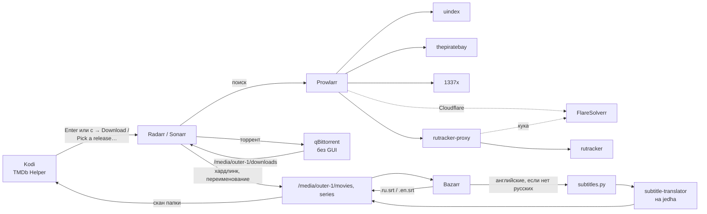

# Movie pipe

Фильмы и сериалы на barnard: нашёл в Kodi → нажал **Download** → через какое-то время фильм лежит в библиотеке с русскими субтитрами рядом, Kodi сам его отсканировал. Всё настроено декларативно в dotfiles, ничего не нужно настраивать руками в веб-интерфейсах.



## Что где

| Что | Где | Зачем |
|---|---|---|
| qBittorrent (headless) | http://127.0.0.1:8140 | качает торренты Radarr/Sonarr, без логина с этой машины. GUI-qBittorrent не трогается |
| Radarr | http://127.0.0.1:7878 | фильмы: ищет, выбирает раздачу, переносит в `movies` |
| Sonarr | http://127.0.0.1:8989 | сериалы, то же для `series` |
| Prowlarr | http://127.0.0.1:9696 | трекеры, отдаёт их Radarr и Sonarr |
| Bazarr | http://127.0.0.1:6767 | субтитры ru и en |
| FlareSolverr | 127.0.0.1:8191 | проходит проверку Cloudflare («Just a moment…») для 1337x и uindex, даёт куку rutracker-proxy |
| rutracker-proxy | 127.0.0.1:8150 | rutracker через Cloudflare: [rutracker-cf-proxy](https://github.com/rofl3228/rutracker-cf-proxy), в Prowlarr — «RuTracker» |

Все веб-интерфейсы только на `127.0.0.1`, снаружи их не видно. В файрволе открыт только порт пиров qBittorrent (51413 TCP/UDP).

Код:

- `nixos/services/arr/default.nix` — сервисы
- `nixos/services/arr/setup.py` — настройка через их API (сервис `arr-setup`, на каждой загрузке и switch)
- `nixos/services/arr/subtitles.py` — перевод субтитров
- `nixos/services/arr/shared.nix` — порты и пути
- `nixos/services/kodi/moviepipe/` — аддон Kodi «Movie pipe»
- `nixos/services/kodi/addons.nix` — все аддоны Kodi

## Один раз: логины

Логины лежат в `secrets/arr.yaml` (sops, как остальные секреты). Все необязательные: без файла пайплайн работает, просто без rutracker, opensubtitles.com и перевода.

```sh
sops secrets/arr.yaml
```

```yaml
rutracker_username: логин
rutracker_password: пароль
# бесплатный аккаунт opensubtitles.com, там большинство русских субтитров
opensubtitles_username: логин
opensubtitles_password: пароль
# ключ LibreTranslate на jedha, тот же, что вводишь на странице subtitle-translator
libretranslate_key: ключ
```

```sh
git add secrets/arr.yaml   # flake видит только файлы в git
sudo nixos-rebuild switch --flake .#barnard
```

После смены файла `arr-setup` перезапускается сам и вписывает логины в Prowlarr и Bazarr.

> [!note] RuTracker
> rutracker закрыт проверкой Cloudflare, туда ходит `rutracker-proxy` (кука от FlareSolverr, запросы как от того же Chrome). Если сам rutracker попросит капчу при входе, Prowlarr покажет её картинкой в Indexers → RuTracker → Test. Или войди один раз на rutracker в браузере с barnard.

## Каждый день

### Найти и скачать

- `5` — TMDb Helper: поиск, популярное, актёры, фильмография режиссёра, похожие.
- Enter на фильме или серии в TMDb Helper — выбор: **Movie pipe: Pick a release…** или **Movie pipe: Download** (у фильма из библиотеки там же «Play with Kodi»).
- На фильме, сериале, сезоне или серии `c` → **Download**: Radarr/Sonarr сами найдут лучшую раздачу и скачают.
  - сериал — спросит, какие сезоны (по умолчанию все);
  - сезон или серия в TMDb Helper — качает именно их.
- `c` → **Pick a release…** — окно с раздачами со всех трекеров. Строка: название, под ним серым колонки: качество (`BDRip 1080p` — лучшее в профиле — выделено белым), SDR / HDR, размер, сиды, трекер, релиз-группа, язык (`RU` — русская озвучка), возраст и «why ✗» (весь интерфейс по-английски). По умолчанию сверху SDR, внутри — в порядке Radarr/Sonarr: сначала те, что они взяли бы сами. `●` — та, которую они скачали бы по **Download**. `✗` — не взяли бы, коротко почему — в последней колонке (`HDR`, `quality not in profile` — качество не из профиля, `few seeders`, `already downloading`, `unknown title`…), полностью — под списком; выбрать можно любую. Названия колонок — кнопки, как в таблице: ↑ с первой строки (или k) переходит на них, ← → между ними, Enter сортирует по колонке, ещё раз — в обратную сторону. Последняя кнопка, «search», оставляет раздачи с текстом в названии, группе, трекере или качестве (например, `playweb`); пустой поиск — снова все. Раздачи других фильмов с тем же названием всегда в самом низу. Esc — ничего не добавляется.
- `6` — окно загрузок, обновляется каждые 2 секунды: состояние, полоска, %, скачано, скорость, сиды (подключено и всего в раздаче, по qBittorrent), сколько осталось, качество, SDR / HDR, трекер. Под списком — полное имя раздачи и ошибки. Справа в строке кнопка ⏸ / ▶: → (l) на неё и Enter, или пробел на строке — пауза или старт в qBittorrent; ← (h) обратно на строку. Enter на строке: **Pause** / **Resume**, **Another release** (эта в чёрный список, ищет следующую) или **Remove**. Его же открывает Movie pipe в «Дополнениях».

SDR / HDR берётся из названия раздачи: `DV` (Dolby Vision; без `HDR10` рядом — только DV), `HDR10`, `HDR10+`, `HDR`, `HLG`, `SDR`. Без пометок: до 1080p — `SDR` (BDRip 1080p — рип обычного Blu-ray, а он всегда SDR; HDR бывает только на UHD Blu-ray), у 2160p — `HDR?` (может быть и то и другое, смотри полное название).

`no peers` и `0 (113)` в сидах — у раздачи 113 сидов, но qBittorrent ни к одному не подключился. Если так долго — проверь, что qBittorrent видит трекер: http://127.0.0.1:8140 → раздача → Trackers.

Kodi показывает уведомления: «Downloading…», «Downloaded…», «Download failed…». Когда фильм перенесён в библиотеку, Kodi сканирует только его папку — фильм появляется сам. Если Kodi был выключен, он догонит при запуске.

Пункты меню есть на фильмах не из библиотеки и на любых сериалах (в том числе из библиотеки — докачать новый сезон).

### Страница фильма: актёры, режиссёр, похожие

- Ряд актёров внизу страницы фильма или сериала — из TMDb (TMDb Helper), а не из библиотеки. Enter на актёре — страница человека.
- More → **MORE BY DIRECTOR** — страница режиссёра (не своя библиотека). Если режиссёров несколько — первого; его ищет TMDb по имени.
- **Страница человека** (как страница фильма Majan): фото, имя, чем известен, дата рождения, возраст, откуда, сколько фильмов и сериалов, биография (Enter на ней — целиком). Под ней кнопки: вкладки **Films** / **TV shows** / **Directed** и порядок **Popular** (самые известные сверху) / **Newest** / **Oldest**; выбранные подчёркнуты. ↓ — ряд постеров (страница уезжает вверх). Enter на фильме — **Download** / **Pick a release…**, `i` — страница фильма, `c` — меню (там тоже Download). По 60 фильмов: последняя плитка **Next page ›**, ← на первой — предыдущая страница. Актёр открывается на фильмах (на сериалах, если открыли из сериала), режиссёр — на Directed.
- More → **SIMILAR** — рекомендации TMDb к этому фильму или сериалу.
- Трейлеры (кнопка Trailer) играет аддон YouTube; ключ API для них обычно не нужен. Если YouTube начнёт требовать ключ — свои ключи (API key, client ID, secret) вводятся в настройках аддона YouTube → API, как делать: [Personal API Keys](https://github.com/anxdpanic/plugin.video.youtube/wiki/Personal-API-Keys).

### Какие раздачи берутся

Профиль качества **BDRip 1080p** (Radarr и Sonarr):

1. Bluray-1080p (BDRip) — лучший
2. 4K (2160p): BDRip, Remux, WEB-DL — только не HDR
3. WEB-DL 1080p
4. 720p (WEB-DL, BDRip) — только если ничего выше нет; потом заменится на 1080p или 4K, когда появится
5. Не берутся автоматически: WEBRip (поток, записанный и пережатый ещё раз — хуже WEB-DL, который сам файл сервиса), HDR в любом качестве, Remux 1080p, BR-DISK, CAM / TS, DVD

Минимальный размер — чтобы не брать пережатое, что видно на большом экране (2 ГБ на фильм 1080p): 1080p — 25 МБ на минуту (фильм на 2 часа — от 3,6 ГБ), 4K — 60 (от 7,2 ГБ), 720p — 12. Меньше — `✗ слишком маленькая`. WEB-DL 1080p обычно 30–60 МБ/мин.

HDR — по названию раздачи: `HDR`, `HDR10`, `HDR10+`, `DV` / `Dolby Vision`, `HLG` (пользовательский формат «HDR», оценка −10000 при минимуме 0). 4K без пометок пройдёт, хотя может оказаться HDR — в окне выбора у него `HDR?`. 4K-рипы и ремуксы с UHD Blu-ray почти всегда HDR, так что 4K SDR — в основном WEB или раздачи с пометкой `SDR`.

Среди одинаковых по качеству выигрывает русская озвучка (+10 к оценке), потом трекер по приоритету: rutracker → uindex → thepiratebay → 1337x, потом больше сидов. Скачанные WEB-DL 1080p и 4K уже не меняются на BDRip 1080p.

Radarr ищет на трекерах по названию без года: у фильма, показанного на фестивале годом раньше, на трекерах часто тот год (Obsession: на TMDb 2026, премьера на TIFF в 2025). Подходящими он считает оба года — выхода и премьеры, фильмы с тем же названием и другим годом отбрасывает.

Имена: `Фильм (2010) {tmdb-27205} [Bluray-1080p].mkv`, сериалы `Сериал (2008) {tmdb-1396}/Season 01/Сериал - S01E01 - Название [WEBDL-1080p].mkv`. `{tmdb-…}` Kodi читает и находит точный фильм на TMDb без поиска по названию.

### Раздача и место

Торренты качаются в `/media/outer-1/downloads`, в библиотеку попадают хардлинками — место не удваивается, раздача продолжается. До рейтинга 2 или 30 дней, потом qBittorrent останавливает торрент, Radarr/Sonarr его удаляют из `downloads`. В библиотеке файл остаётся.

## Субтитры

Bazarr ищет для каждого нового фильма и серии **русские и английские** (профиль «Russian, English»). Русские не ищутся, если в видео есть русская дорожка.

Провайдеры: opensubtitles.com (нужен аккаунт), YIFY (фильмы), TVsubtitles (сериалы), embeddedsubtitles — достаёт дорожки субтитров из самого видео в отдельный файл.

Перевод (`subtitles.py`):

1. Bazarr скачал английские → кладёт их в очередь `/var/lib/arr/subtitles`.
2. Через 2 минуты (Bazarr за это время успевает найти русские, если они есть) проверка: есть ли рядом `.ru.srt`, русская дорожка или русские субтитры внутри видео. Есть — ничего не делает.
3. Нет — отправляет английские на subtitle-translator jedha (LibreTranslate): сначала через `jedha-tunnel` (`127.0.0.1:5390`), если не отвечает — через `lt.vxrnt.ru`.
4. Результат кладёт рядом с видео как `Фильм….ru.srt`. mpv подхватывает его сам.

Файлы по одному, сезон сериала переводится по серии. Ошибка (jedha выключен) — повтор через 30 мин, 1 ч, 2 ч… всего 6 попыток. Переведённые Bazarr считает русскими и больше русские для этого видео не ищет.

## Прокси

Radarr, Sonarr, Prowlarr и Bazarr ходят в интернет через xray (`127.0.0.1:10808`), qBittorrent — никогда; напрямую только локальная сеть и `127.0.0.1`. Причина: серверы Prowlarr (описания трекеров, проверка FlareSolverr), Radarr и Sonarr стоят за Cloudflare, а провайдер его режет — напрямую Prowlarr не мог скачать описания uindex, TPB и 1337x. Пока xray выключен, поиск не работает. Выключить: `useProxy = false;` в `nixos/services/arr/default.nix`. Для самого Kodi (постеры TMDb) — свой `useProxy` в `nixos/services/kodi/default.nix`.

## ТВ

`4` — каналы. Списки бесплатных каналов iptv-org: «Russia» (Первый, Россия 1, НТВ и другие) и «News» (новости со всего мира: LiveNOW from FOX, CBS News, Bloomberg, Sky News, DW…). Сам Fox News Channel платный, бесплатно его нет. ТВ и стримы играют во встроенном плеере Kodi, файлы библиотеки — в mpv.

Списки задаются в `nixos/services/kodi/default.nix` (`channels`), в Kodi они пишутся один раз; потом их можно менять в настройках IPTV Simple Client прямо в Kodi.

## Вид и звуки

Из скинов остался только Majan, шрифт JetBrains Mono (с кириллицей). Ставится само, пока в Kodi стоит значение по умолчанию; если Kodi был открыт во время switch — со следующего switch. Своих звуков нет, их выбирают в Kodi: Settings → Interface → Skin → Navigation sounds (например, Titan). Шрифт там же, Fonts.

Ряды постеров на главной и во вкладках заканчиваются у правого поля страницы — ровно и при уменьшенном масштабе скина (Settings → Interface → Skin → Zoom). На главной блок spotlight поднят ближе к панели, у «Newest additions» больше места до постеров, рамка выбранного постера внизу помещается и при 100%. Шрифт JetBrains Mono на 12% меньше шрифтов Majan — моноширинный шире (мелкие подписи Majan прежние).

Номер в шапке страницы — клавиша, которая её открывает: `01`–`03` вкладки главной, `04` ТВ, `05` TMDb Helper, `06` загрузки, `/` поиск. У Majan на главной есть ещё вкладка «04 Music» — если музыка в Kodi не нужна, её скрывают в настройках скина: Main menu → Music → Hide.

TMDb Helper запускает плееры Movie pipe без своего пустого `dummy.mp4` (иначе он секунду играл бы в mpv): аддон Movie pipe включает в нём `only_resolve_strm` при каждом старте Kodi.

## Если что-то не так

```sh
systemctl status arr-setup radarr sonarr prowlarr bazarr qbittorrent flaresolverr
journalctl -u arr-setup -b       # что настроилось, что нет; при ошибке сам повторит через 30 мин
journalctl -u arr-subtitles -f   # перевод субтитров
ls /var/lib/arr/subtitles        # очередь перевода
journalctl -u radarr -f          # поиск и импорт фильмов
```

- Ничего не находит — Prowlarr → Indexers → Test all. Красные 1337x/uindex — FlareSolverr (`journalctl -u flaresolverr`); всё красное — xray (v2rayN) выключен.
- Красный RuTracker — `curl -s 127.0.0.1:8150/health` (есть ли кука Cloudflare, `last_error`) и `journalctl -u rutracker-proxy`. Капчу на входе Prowlarr показывает картинкой: Indexers → RuTracker → Test, ввести код. Или один раз войти на rutracker в браузере с barnard.
- «radarr не ответил за 150 с» или ошибка при **Download** / **Pick a release…** на новом фильме — Radarr не дождался своего сервера фильмов (api.radarr.video, ходит через xray): `journalctl -u radarr -b -n 200` — первая строка ошибки перед `SkyHookProxy`. Повтори через минуту; если так всегда — xray.
- Скачалось, но нет в Kodi — Radarr → Activity → Queue (ошибка импорта), или `f` в Kodi.
- Нет субтитров — Bazarr → Wanted / History.
- Переводчик: `curl -s http://127.0.0.1:5390/subtitle-translator/api/languages` должен вернуть список языков. `LibreTranslate unreachable` — на jedha лежит LibreTranslate (`systemctl status libretranslate`).
- Настройки из веб-интерфейсов не трогаются, кроме тех, что задаёт `setup.py` (профиль, клиент загрузок, именование, трекеры, языки Bazarr) — их он вернёт на следующем запуске.
